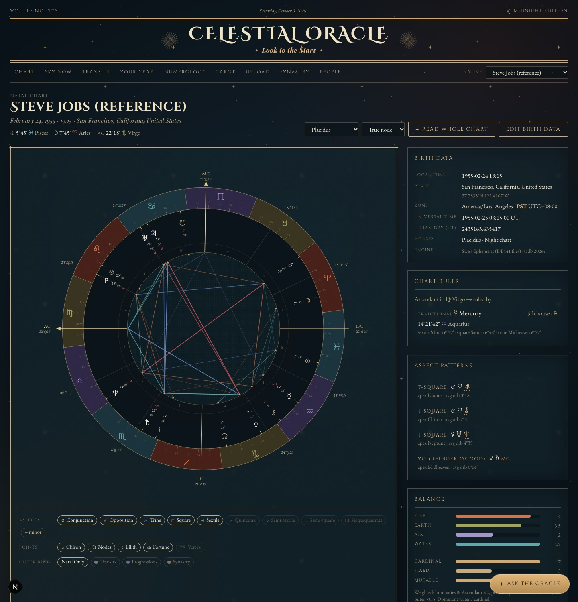
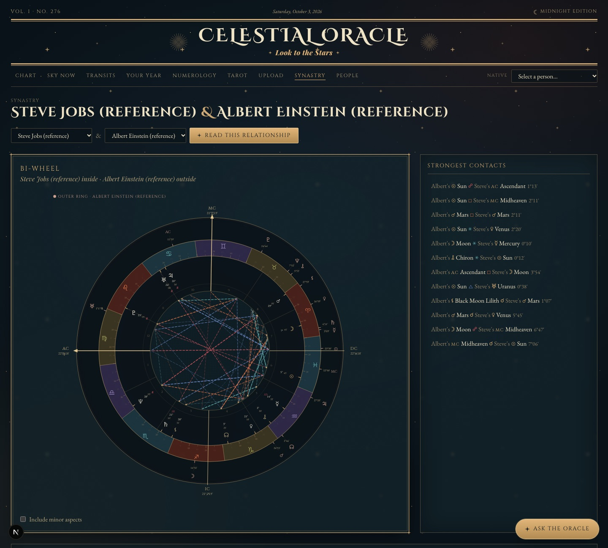
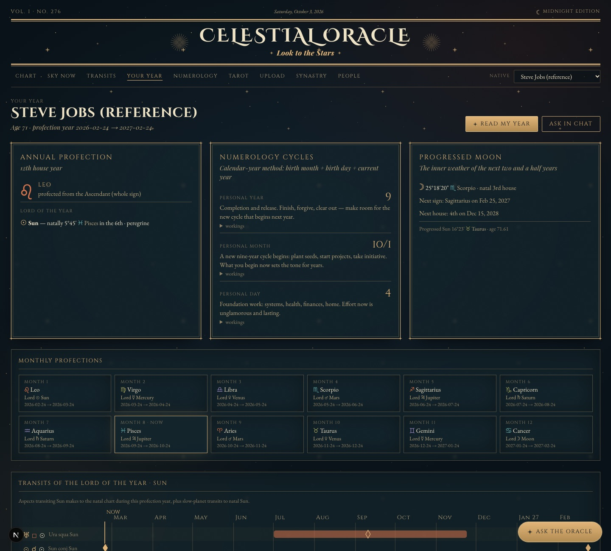
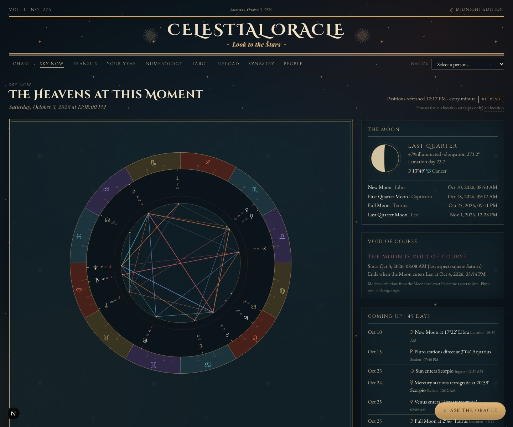
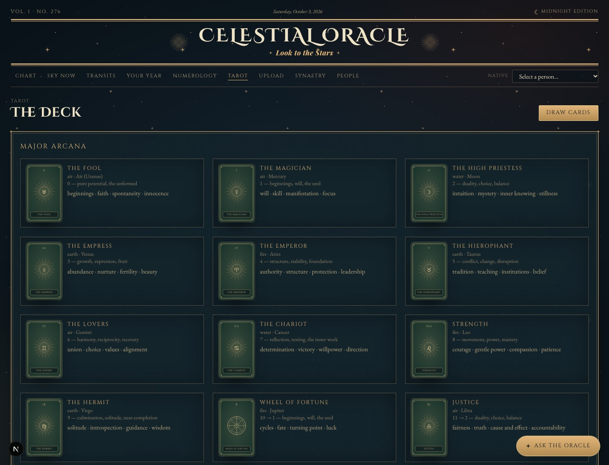

# Celestial Oracle

**An astrology, numerology and tarot workstation with an AI interpreter that is not allowed to make things up.**

Every planetary position is calculated with the Swiss Ephemeris and verified against astro.com to the
arcsecond. Birth times go through the full-history IANA time zone database. Claude then interprets *only*
what the engine calculated, and calls the engine through tools whenever it needs a date or position it doesn't have.



## Highlights

- **Verified accuracy.** Five Astro-Databank reference charts, including Local Mean Time and US War Time
  births, match astro.com to **0.000″** for every planet, angle and house cusp. The test suite enforces it.
- **Grounded AI.** Interpretations and chat are built from engine output. The chat has nine engine tools
  (exact aspect dates, retrograde passes, ingresses, progressions, profections, numerology) so answers like
  "when does Saturn square my Sun?" are calculated rather than guessed.
- **Claude API features used in production style:** streaming, tool use, prompt caching, adaptive thinking
  with effort control, vision, and structured outputs (chart image or PDF → validated JSON → recalculated chart).
- **Hand-built SVG chart wheel** with collision-avoided glyphs, aspect lines, hover details,
  click-to-interpret, and transit, progression and synastry overlays.
- **Historical time zones done properly.** Ships a tz database compiled *with* IANA backzone data, because
  Node's built-in tz data silently gets many pre-1970 births wrong.
- **A design system extracted from five vintage reference images** (newspaper horoscope, zodiac poster,
  tarot collage, star chart, engraving), with two themes: Midnight and Almanac.
- **128 tests** (Vitest), strict TypeScript, zero lint warnings.

| | |
|---|---|
|  |  |
| **Synastry**: bi-wheel, strongest contacts, composite chart | **Your Year**: profections, Lord of the Year, cycles, transit timeline |
|  |  |
| **Sky Now**: live positions, Moon phase, void-of-course, upcoming events | **Tarot**: 78 cards with correspondences, spreads and a journal |

---

## Built with AI

This project is an experiment in directing an AI coding agent through a large, accuracy-critical build.

**How it was made.** I wrote the product spec: the features, the priorities (calculation accuracy first,
then interpretive depth, then visual polish), the tech stack, and five reference images for the visual
direction. I then built it with [Claude Code](https://claude.com/claude-code) (Claude Opus 5.5) in phases,
checking the running app at each checkpoint and changing direction where needed. For example, I moved the AI
chat earlier in the plan once I saw the first phases. I also tested it with friends and fed real bugs back in.

**Making the AI prove its work.** Astrology software is easy to get subtly wrong. A Moon that is off by a
few arcminutes, or a birth hour shifted by a historical time zone change, still looks plausible. So the spec
required unit tests against an external authority (astro.com) within 1′, rather than trusting the agent's
own claims. That requirement surfaced real problems that had to be solved: zones merged after 1970 in the
standard tz data, Local Mean Time births, and wartime offsets.

**How the app itself uses Claude** (`src/lib/ai/`):

| Technique | Where | Why |
|---|---|---|
| Grounded prompting | `context.ts`, `prompts.ts` | Each request carries the engine's computed facts; the system prompt forbids inventing positions |
| Tool use (9 tools) | `tools.ts`, `chat.ts` | The chat calls the Swiss Ephemeris engine for dates and positions instead of guessing; inputs are stream-parsed and validated with zod |
| Streaming | `client.ts`, `/api/chat` | Interpretations and chat render token by token |
| Prompt caching | `chat-context.ts` | A person's full chart context is cached across turns of a conversation |
| Append-only conversation storage | `db/chat.ts` | Messages are stored exactly as returned and only appended to, so replayed thinking stays valid |
| Adaptive thinking + effort | `chat.ts`, `/api/interpret` | Deeper reasoning for year and relationship overviews; a "Deep" toggle in chat |
| Vision + structured outputs | `/api/upload/extract`, `upload/schema.ts` | Reads a chart screenshot or PDF into a strict JSON schema, then recalculates it from the birth data and diffs the two |
| Interpretation cache | `cache.ts` | Interpretations are cached in SQLite by chart, target and prompt version |

## Tech stack

| Layer | Choice |
|---|---|
| App | Next.js 16 (App Router) · TypeScript · Tailwind CSS v4 |
| Ephemeris | Swiss Ephemeris via `sweph` (ephemeris files included, 1800–2400 CE) |
| Time | Luxon, plus a custom zone backed by IANA tzdb with backzone; `geo-tz` for coordinate → zone lookup |
| Geocoding | OpenStreetMap Nominatim (rate-limited and cached, per its usage policy) |
| AI | Anthropic API (`@anthropic-ai/sdk`), server-side only |
| Storage | SQLite (`better-sqlite3`) |
| Tests | Vitest |

---

## Setup

### Prerequisites

| | |
|---|---|
| **Node.js** | 20 or newer (developed on Node 24) |
| **Build tools** | Needed to compile the native `sweph` and `better-sqlite3` modules. macOS: `xcode-select --install`. Linux: `build-essential` and `python3`. Windows: the "Desktop development with C++" workload. |

### Install and run

```bash
git clone https://github.com/ushygushhy/celestial-oracle.git
cd celestial-oracle
npm install
cp .env.example .env.local     # then add your API key (see below)
npm run dev
```

Then open **http://localhost:3000**. The home page's *Observatory Status* panel shows whether the ephemeris
files, time-zone data and API key were all found.

Everything else is already in the repo:

- `ephe/`: Swiss Ephemeris data files `sepl_18.se1` (planets), `semo_18.se1` (Moon) and `seas_18.se1`
  (asteroids, including Chiron). They cover 1800–2400 CE.
- `data/tz-history.json`: IANA tz 2026e compiled **with backzone** (see §4).
- `data/celestial.db`: your SQLite database, created on first run.

### Adding your Anthropic API key

1. Go to <https://console.anthropic.com/> → **API Keys** → **Create Key**, and copy the key (it starts with `sk-ant-`).
2. Create a file called `.env.local` in the `celestial-oracle/` folder, next to `package.json`:

   ```bash
   ANTHROPIC_API_KEY=sk-ant-your-key-here
   ```

3. Restart `npm run dev`. Environment files are only read at startup.

The key is only used server-side, in the API routes, and never reaches the browser. `.env.local` is git-ignored.
All calculations work without a key. Only the interpretation panels need one.

Optional settings for `.env.local`:

```bash
ANTHROPIC_MODEL=claude-opus-5-5        # default
NOMINATIM_CONTACT=you@example.com      # added to the geocoder User-Agent (OSM policy courtesy)
SE_EPHE_PATH=/abs/path/to/ephe         # default ./ephe
DATABASE_PATH=/abs/path/to/celestial.db
```

### Useful scripts

| Command | What it does |
|---|---|
| `npm run dev` | Starts the app |
| `npm test` | Runs the accuracy suite and unit tests (Vitest) |
| `npm run typecheck` | Runs `tsc --noEmit` |
| `npm run build:tz` | Rebuilds `data/tz-history.json` from the latest IANA release |

---

## Accuracy

`npm test` runs `tests/engine.reference.test.ts`. It feeds **only the local birth data** (date, clock time and
coordinates) through the whole pipeline: timezone lookup → historical UTC offset → Julian day → Swiss Ephemeris.
It then compares the results with astro.com.

| Reference (Astro-Databank) | Rating | What it stresses |
|---|---|---|
| Steve Jobs, 1955 San Francisco | AA | Standard time; Placidus, Koch, Porphyry, Equal and Whole Sign cusps |
| Barack Obama, 1961 Honolulu | AA | Hawaii standard time |
| Diana, Princess of Wales, 1961 Sandringham | A | British Summer Time |
| Albert Einstein, 1879 Ulm | AA | **Local Mean Time** (before standard time existed) |
| Jimi Hendrix, 1942 Seattle | AA | **US War Time** (year-round daylight time) |

Expected values come from astro.com's own Swiss Ephemeris output (`astro.com/cgi/swetest.cgi`) for the UT that
Astro-Databank's timezone implies. Sun, Moon and Ascendant are also checked against Astro-Databank's published
strings. **Result: every planet, node, Lilith and Chiron matches to 0.000″**, and so do all angles and cusps.
The spec required 1′. The suite also covers:

- Amsterdam 1930: Amsterdam Mean Time, +0:19:32 (not Brussels time)
- Dutch summer time
- Birthplace LMT before 1835
- DST gaps (clock times that never existed) and overlaps (clock times that happened twice)
- Manual offset overrides
- India's WWII war time
- Unknown birth time (noon chart, no houses or angles)
- Porphyry fallback inside the polar circle

---

## Features

**Design system**: `src/styles/tokens.css` is the single source of truth. `src/lib/design/tokens.ts` gives the
SVG wheel access to the same CSS variables. All values were sampled from the five reference images using k-means
clustering:

| Token family | Source | Examples |
|---|---|---|
| Midnight | img 4/5 night skies | `#0f1e24`, `#14242b`, `#273e53` |
| Gilt | img 5 linework, img 3 frames | `#cca874`, highlight `#e1b478`, bronze `#977049` |
| Parchment | img 2 wheel, img 3 | `#d8c398`, `#efe3c6` |
| Almanac rose | img 1 cloth and ink | `#865f4d`, ink `#180e0b` |
| Jewels (elements) | img 2 medallions | rust `#782b1c`, olive `#756438`, lapis `#1b255b`, teal `#264a55` |
| Type | img 1 and 3 | Cinzel (engraved caps), Cinzel Decorative (masthead), Playfair italic (headlines), EB Garamond (text), Noto Sans Symbols (glyphs) |
| Texture | img 2/4/5 | starfield with four-point sparkles, print grain, stipple, double gilt frame with corner stars, thick–thin newspaper rules |

There are two editions: **Midnight** (gilt on navy, the default) and **Almanac** (black ink on dusty-rose
newsprint, after image 1). Switch between them in the top-right corner.

**Engine**: `src/lib/astro/`

| File | Contents |
|---|---|
| `time.ts`, `tz.ts` | Local time → UTC: historical offsets, LMT, DST gap/overlap detection |
| `ephemeris.ts` | Typed `sweph` wrapper |
| `chart.ts` | Every point, with sign, exact degree, house, retrograde/station, decan, dignities (including Lilly score), declination and out-of-bounds; 7 house systems; chart ruler; sect; Part of Fortune; dispositors |
| `aspects.ts` | 9 aspect types with configurable orbs; exact orb, applying/separating, out-of-sign |
| `patterns.ts` | Stelliums, T-squares, Grand Trines, Grand Crosses, Yods, Kites, Mystic Rectangles |
| `progressions.ts` | Secondary progressions; angles by solar arc in right ascension |
| `positions.ts` | Positions at any moment (transits) |

**Chart page**: `/chart/[id]`

- An interactive SVG wheel: 1° ticks with labels every 5°, cusps with degree labels, angle axes, collision-avoided
  glyphs with leader lines, and aspect lines colored by type
- Hover tooltips on every glyph, cusp and aspect
- Click a planet, house, aspect or pattern to open a streamed interpretation, grounded in the computed data and
  cached in SQLite
- Toggles for each aspect type, the minor aspects and the optional points
- An outer ring for **transits**, **secondary progressions** or **synastry** with any saved person, with
  cross-aspect lines
- Tables: placements, houses (with rulers and occupants), aspectarian grid and aspect list; plus birth data and
  UTC conversion, chart ruler, patterns, and element/modality/hemisphere balance

**Ask the Oracle (AI chat)**: the gold button at the bottom right of every page.

- Pick a saved person or "no one in particular". Each conversation includes that person's full natal chart,
  today's transits, progressions, profection year and numerology.
- When a question needs a date or position the context doesn't have ("When does Saturn square my Sun?",
  "Where was Venus on my wedding day?"), the Oracle calls the Swiss Ephemeris engine through tools instead of
  guessing. It can look up positions at any moment, transits on a date, exact aspect dates (including every
  retrograde re-pass, orb windows and near-misses), ingresses and stations, progressions, profections and
  numerology.
- You can drop or paste chart screenshots and PDFs into the chat.
- **Deep** mode thinks longer, for richer answers.
- Conversations are saved in SQLite. They are stored exactly as the API returned them and only ever appended
  to, which the API requires when a conversation is replayed.
- Every interpretation panel has an **Ask a follow-up** button that continues the topic in the chat.

**People**: create, edit and delete; quick-switch from the masthead. Birth places are found with OpenStreetMap
Nominatim. Nominatim is only called when you press **Enter** or **Search**, because its usage policy forbids
per-keystroke autocomplete. Suggestions while you type come from your local cache and saved places. Results are
cached permanently, requests are throttled to one per second, and the app sends an identifying User-Agent.

**More pages**:

- **Sky Now** (`/sky`): live positions refreshed every minute, Moon phase, void-of-course Moon, ingresses, stations, lunations and eclipses
- **Transits** (`/transits/[id]`): transits in effect now, exact dates for every retrograde pass, a 12-month Gantt timeline, heavy hitters, house ingresses, eclipses on natal points
- **Your Year** (`/year/[id]`): annual and monthly profections, transits by and to the Lord of the Year, solar return at a chosen location, progressed Moon timing, an AI synthesis of the year
- **Numerology** (`/numerology`): Pythagorean and Chaldean systems; pinnacles, challenges, karmic debt and karmic lessons, with full workings
- **Tarot** (`/tarot`): 78 cards (original meanings, Golden Dawn correspondences), several spreads plus a custom spread builder, shuffle and flip animations, a journal, and readings linked to transits
- **Upload** (`/upload`): reads a chart image or PDF into an editable table, recalculates from the birth data, and compares the upload with the calculated chart
- **Synastry** (`/synastry`): bi-wheel, inter-aspect grid, house overlays in both directions, midpoint composite chart, AI relationship reading

---

## Notes on time zones

Node's built-in time-zone data (ICU) and every npm tz package ship the *merged* IANA database. Since tzdata 2022b,
that database has erased pre-1970 history for many zones; for example, Europe/Amsterdam became an alias of
Europe/Brussels. A Dutch birth in 1930 would come out 19 minutes 32 seconds wrong, roughly 5° of Ascendant.

`scripts/build-tz-history.mjs` downloads the official IANA source, builds it with
`PACKRATDATA=backzone PACKRATLIST=zone.tab` using IANA's own `zic`, and converts the result to JSON. `src/lib/astro/tz.ts`
plugs that data into Luxon as a custom `Zone`.

Before standard time existed in a region, the tz database labels the period "LMT". The engine then uses the
**birthplace's** Local Mean Time (longitude × 4 minutes), as astro.com does. For those births, the place's exact
coordinates therefore matter to the second.

If a record says "EWT" or gives a specific offset, or you have reason to doubt the database, use **Show timezone
overrides** on the birth-data form. There you can force an IANA zone or a manual UTC offset.

---

## What leaves your machine

- **Place searches**: the text you search for is sent to nominatim.openstreetmap.org.
- **Interpretations and chat**: when you open an interpretation or send a chat message, the computed chart
  data (and any image you attach) is sent to the Anthropic API.

Everything else (people, charts, cached interpretations) stays in `data/celestial.db`.

---

## License

[AGPL-3.0-or-later](LICENSE). The project links the Swiss Ephemeris, which Astrodienst AG distributes under the
AGPL (or a commercial license), so this project uses the same license. Time zone data comes from the public-domain
IANA tz database. Place search uses OpenStreetMap data © OpenStreetMap contributors.
